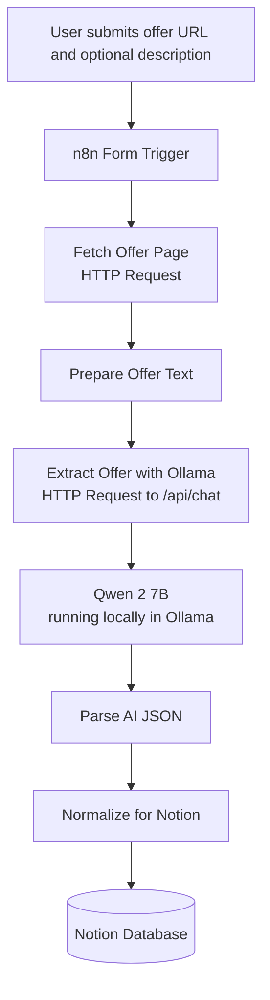

# AI-Powered PFE Application Tracker

A personal automation project that turns job-offer information into structured records in a Notion database, using n8n for orchestration and a locally hosted LLM (Qwen 2 via Ollama) for information extraction.

> **Status: work in progress.** This repository documents what has been implemented so far. Planned features are listed separately in [Future Improvements](#future-improvements) and are not part of the current implementation.

## Table of Contents

- [Overview](#overview)
- [Problem Statement](#problem-statement)
- [Objectives](#objectives)
- [Implemented Features](#implemented-features)
- [Technology Stack](#technology-stack)
- [Architecture](#architecture)
- [Workflow Description](#workflow-description)
- [Extracted Fields](#extracted-fields)
- [Prerequisites](#prerequisites)
- [Installation and Configuration](#installation-and-configuration)
- [Importing and Running the Workflow](#importing-and-running-the-workflow)
- [Testing and Troubleshooting](#testing-and-troubleshooting)
- [Privacy, Security, and Cost](#privacy-security-and-cost)
- [Known Limitations](#known-limitations)
- [Future Improvements](#future-improvements)
- [Learning Outcomes](#learning-outcomes)
- [Author](#author)

## Overview

Final-year engineering internships (PFE in the French/Moroccan academic system) are usually found across many job boards and company websites. Each offer has a different layout and level of detail, which makes it hard to compare opportunities and track applications consistently.

This project is an n8n workflow that accepts a job-offer URL and an optional pasted description, retrieves the page when possible, asks a local LLM to extract structured JSON, normalizes the result, and creates a page in a Notion database.

## Problem Statement

Tracking internship applications manually involves repetitive copy-and-paste work: identifying the company, title, location, duration, required skills, deadlines, and contact details, then entering them into a tracking tool. The information is unstructured, spread across different websites, and easy to lose or misrecord.

This project investigates whether a small local LLM, combined with a workflow automation tool, can reduce that manual effort while keeping the data in a single, searchable place.

## Objectives

- Reduce repetitive manual data entry when collecting internship opportunities.
- Convert unstructured job-offer text into structured JSON.
- Centralize extracted information in a Notion database.
- Explore local LLM inference in an automation workflow, without paid hosted LLM API calls.
- Gain practical experience with workflow orchestration, prompt design, and API integration.

## Implemented Features

- **Form-based input:** an n8n form accepts a job-offer URL and a job description.
- **Page retrieval attempt:** an HTTP request tries to fetch the offer page. This can fail on sites that block automated requests (see [Known Limitations](#known-limitations)).
- **Text preparation:** the available offer content is prepared as input for the model.
- **Local LLM extraction:** the workflow calls Ollama's HTTP API with the `qwen2:7b` model and requests JSON output.
- **JSON parsing:** the model response is parsed into a structured object.
- **Data normalization:** a JavaScript step converts arrays and numbers to text, applies fallbacks for missing values, and shapes values to match the Notion properties.
- **Notion storage:** a database page is created for each processed offer.

## Technology Stack

| Technology | Role |
|---|---|
| [n8n](https://n8n.io/) | Workflow automation and orchestration |
| [Ollama](https://ollama.com/) | Runs the LLM locally and exposes an HTTP API |
| [Qwen 2](https://github.com/QwenLM/Qwen2) (`qwen2:7b`) | Extracts structured information from job-offer text |
| [Notion](https://www.notion.so/) | Stores and organizes the extracted records |
| Docker Desktop | Runs n8n in a container |
| HTTP / REST APIs | Communication between n8n, Ollama, Notion, and job pages |
| JavaScript | Text preparation, JSON parsing, and data normalization inside n8n |

## Architecture



### Workflow screenshot


*Screenshot of the workflow in the n8n editor.*

Components run in different places:

| Component | Where it runs |
|---|---|
| n8n | Local Docker container |
| Ollama and Qwen 2 | Local machine (host) |
| Job page retrieval | Remote website, over the internet |
| Notion | Notion's cloud service, over the internet |

## Workflow Description

The workflow runs as the following sequence of nodes. Names reflect the current build and may change as the workflow evolves.

| Step | Node | Responsibility |
|---|---|---|
| 1 | **PFE Offer Form** (Form Trigger) | Collects the offer URL and a job description. Entry point of the workflow. |
| 2 | **Fetch Offer Page** (HTTP Request) | Attempts to download the page at the submitted URL. Some sites return access-denied responses or security challenges, so this step may not yield usable content. |
| 3 | **Prepare Offer Text** (Code / JavaScript) | Assembles the text sent to the model from the retrieved page content and/or the manually supplied description, together with the offer URL. |
| 4 | **Extract Offer with Ollama** (HTTP Request) | Sends a request to Ollama's `/api/chat` endpoint using `qwen2:7b`, with a system prompt that asks for JSON only, forbids inventing missing information, and requires `null` for unavailable fields. |
| 5 | **Parse AI JSON** (Code / JavaScript) | Parses the JSON string returned in the model's message content into an object. |
| 6 | **Normalize for Notion** (Code / JavaScript) | Converts arrays (skills, missions) to readable text, converts numeric values such as duration to text, applies fallbacks for missing fields, and aligns values with the Notion property types. |
| 7 | **Notion** (Notion node) | Creates a page in the target database with the normalized values. |

## Extracted Fields

The extraction prompt asks the model to return the following fields. Fields not present in the offer should be returned as `null`.

| Field | Description |
|---|---|
| Company | Company or organization name |
| Job Title | Internship or position title |
| Offer URL | Original job-offer link |
| Location | City, region, or country |
| Contract Type | Internship or contract type, when specified |
| Duration | Internship duration |
| Start Date | Expected start date |
| Application Deadline | Application closing date |
| Key Skills | Technical and professional skills requested |
| Missions | Main responsibilities |
| Profile Requirements | Expected qualifications and background |
| Languages | Required languages |
| Salary | Compensation or internship allowance, when specified |
| Remote Policy | On-site, hybrid, or remote arrangement |
| Contact Email | Contact email, when available |
| Contact Phone | Contact phone number, when available |
| Application Priority | Indicative priority assigned by the model during extraction |
| Matching Keywords | Relevant terms identified in the offer |

> **Note:** Values come from an LLM and may be incomplete or wrong. *Application Priority* in particular is a model-generated suggestion, not a validated score. Always review extracted records.

## Prerequisites

- Windows, macOS, or Linux
- [Docker Desktop](https://www.docker.com/products/docker-desktop/) or another Docker environment
- [Ollama](https://ollama.com/download) installed and running
- The `qwen2:7b` model pulled in Ollama (the model is several GB; check available disk space and RAM)
- An n8n instance (the Docker command below is one option)
- A Notion account, a database prepared for job offers, and a Notion integration with access to it

## Installation and Configuration

### 1. Install Ollama and pull the model

Install Ollama from <https://ollama.com/download>, then:

```bash
ollama pull qwen2:7b
ollama list
```

Optional check that the API responds:

```bash
curl http://localhost:11434/api/tags
```

### 2. Start n8n with Docker

If you do not already run n8n, this example starts a local instance:

```bash
docker run -it --rm \
  --name n8n \
  -p 5678:5678 \
  -v n8n_data:/home/node/.n8n \
  docker.n8n.io/n8nio/n8n
```

Open <http://localhost:5678>. The named volume `n8n_data` keeps workflows and credentials between runs, even though the container is removed on exit (`--rm`).

If you already have an n8n instance, you can keep using it.

### 3. Configure the Ollama connection

n8n runs inside a container, so `localhost` inside n8n refers to the container, not your machine. With Docker Desktop on Windows or macOS, use the special host name:

```text
Base URL:   http://host.docker.internal:11434
Chat route: http://host.docker.internal:11434/api/chat
```

On Linux, `host.docker.internal` is not defined by default. Add `--add-host=host.docker.internal:host-gateway` to the `docker run` command, and make sure Ollama listens on an address reachable from the container (for example by setting `OLLAMA_HOST=0.0.0.0`, understanding that this exposes Ollama to your network unless firewalled).

Example request body for the HTTP Request node:

```json
{
  "model": "qwen2:7b",
  "stream": false,
  "format": "json",
  "messages": [
    {
      "role": "system",
      "content": "Extract structured information from the supplied job offer. Return only valid JSON. Do not invent missing information. Use null when a field is unavailable."
    },
    {
      "role": "user",
      "content": "Analyze the supplied job offer."
    }
  ]
}
```

This body is a minimal template. In the actual workflow, the user message is built dynamically from the submitted URL and the prepared offer text, and the system prompt lists the fields described in [Extracted Fields](#extracted-fields).

With `"stream": false`, Ollama returns a single JSON response. The model's output is in `message.content` as a JSON string, which the *Parse AI JSON* step converts to an object.

### 4. Configure Notion

1. Create an internal integration at <https://www.notion.so/profile/integrations>.
2. Share the target database with the integration (database menu, then *Connections*).
3. Add the Notion credential in n8n using the integration token.
4. Select the target database in the Notion node.
5. Map each normalized field to the matching database property.

Property types must match the values being sent. For example, the job title maps to the database's **Title** property, while skills and missions can be stored as **Text** (rich text). Keep property names in the database identical to those referenced in the node.

## Importing and Running the Workflow

1. Open n8n and create a new workflow.
2. Choose **Import from File** (or paste JSON) and select the workflow export from `workflows/`.
3. Re-create or re-select credentials (Notion). Credential secrets are not included in n8n exports.
4. Verify the Ollama URL in the HTTP Request node.
5. Verify the Notion database selection and property mapping.
6. Open the form node, copy its **Test URL**, and submit a sample offer.
7. Check the execution view in n8n, then confirm that a page was created in Notion.

Test with a sample offer before using the workflow on real applications.

### Sanitizing the workflow before publishing

An n8n export does not contain credential secrets, but it can still include sensitive data. Before committing it:

1. Open the JSON and search for tokens and identifiers:

   ```bash
   grep -nEi "secret_|ntn_|token|api[_-]?key|password|bearer|authorization" workflow.json
   ```

2. Check for personal data: email addresses, phone numbers, names, and real job-offer URLs.
3. Remove `pinData` (saved test data from executions), which often contains real inputs and outputs:

   ```bash
   jq 'del(.pinData)' workflow.json > workflow.sanitized.json
   ```

4. Review Notion database IDs, webhook paths, and credential names or IDs, and replace them with placeholders if you prefer not to expose them.
5. Re-import the sanitized file into a fresh n8n instance to confirm it still loads.
6. Review the final file manually, line by line, before pushing it to a public repository.

## Testing and Troubleshooting

### Suggested test cases

| Case | Expected behavior |
|---|---|
| Offer URL that is publicly accessible | Page content is retrieved and extraction proceeds |
| URL that blocks automated requests, with a pasted description | Extraction relies on the pasted description |
| Description with missing fields (for example no salary) | Missing fields come back as `null` and are handled by the fallback |
| Very long description | Check whether the extraction remains complete (see context-window note below) |

### Common issues

| Symptom | Likely cause and suggested action |
|---|---|
| Connection refused when calling Ollama | n8n cannot reach the host. Use `host.docker.internal` instead of `localhost`; on Linux add the host mapping and check the Ollama bind address. |
| Model not found | Run `ollama list` and confirm `qwen2:7b` is installed and spelled identically in the request body. |
| HTTP 403 or a security-check page when fetching the offer | The site blocks automated requests. Paste the description manually in the form. |
| Invalid or empty JSON from the model | Re-run, shorten the input, and check that `"format": "json"` is set. Add validation in the parsing step. |
| Incomplete extraction on long offers | The model's context window may truncate input. Consider setting a larger context size through the Ollama `options` field (for example `num_ctx`) and testing the effect. |
| Notion node returns a validation error | A property name or type does not match the value sent. Compare the normalized output with the database schema. |
| Notion error on long text | Notion limits the size of individual rich-text blocks. Truncate or split long fields such as missions. |
| Slow responses | A 7B model running on CPU can be slow. Performance depends on your hardware. |

## Privacy, Security, and Cost

**Local inference is not the same as offline operation.** Qwen 2 runs on your machine through Ollama, so offer text is not sent to a hosted LLM API. The overall workflow, however, still requires internet access:

- Fetching job pages contacts the target websites.
- Notion is an external cloud service. Extracted data, including any contact details found in offers, is stored there.
- Notion credentials are stored in your n8n instance.

Recommendations:

- Never commit credentials, tokens, or `.env` files. Use n8n's credential manager.
- Sanitize workflow exports as described above.
- Avoid publishing real application data, personal emails, or screenshots showing private database content.
- Keep the Ollama API bound to localhost unless you have a reason to expose it.

**Cost:** the workflow does not use paid LLM API calls. Costs are limited to local hardware resources and your existing Notion plan. Docker Desktop and n8n licensing terms may depend on your usage; check their current terms.

## Known Limitations

- Some job websites block automated page retrieval, so a manual description may be required.
- Extraction quality depends on the available offer text and on the capability of a 7B-parameter model.
- LLM output is not guaranteed to be correct; extracted data requires validation.
- Missing or ambiguous information may need manual review.
- The workflow has not been validated across a broad range of offer formats.
- Duplicate detection, application analytics, and status tracking are not implemented.

## Future Improvements

These are planned ideas, not current features:

- Duplicate detection based on offer URLs
- Improved error handling and output validation
- Comparison between offer requirements and a candidate's skills
- Job relevance scoring
- Application status tracking
- Deadline notifications
- Dashboards for application progress

## Learning Outcomes

- Workflow orchestration with n8n
- Local LLM integration with Ollama
- HTTP requests and REST API communication
- Prompt design for structured extraction
- JSON parsing and data normalization in JavaScript
- Integrating an AI workflow with Notion
- Practical limits of web-page retrieval and LLM-based extraction

## Author

**Wiame Erraoui**
Final-year engineering student in Computer Engineering and Artificial Intelligence, interested in Data Engineering, Data Analytics, and Applied AI.

This project is part of my exploration of practical AI solutions and workflow automation.