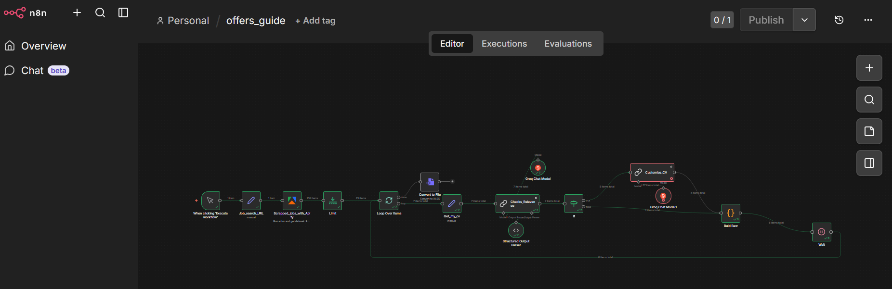
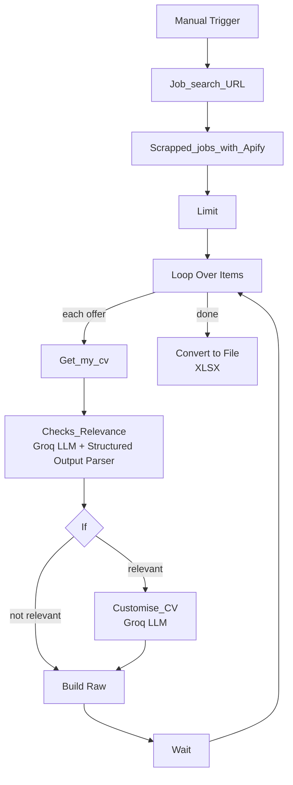

# offers_guide

An n8n workflow that collects job offers with Apify, uses an LLM (Groq) to check how well each offer matches my CV, tailors the CV for the relevant ones, and exports the results to an Excel file.

> **Status:** personal project. This README describes the workflow as built in n8n. LLM output may be inaccurate and should be reviewed before use.

## Table of Contents

- [Purpose](#purpose)
- [Workflow Screenshot](#workflow-screenshot)
- [How It Works](#how-it-works)
- [Nodes](#nodes)
- [Technology Stack](#technology-stack)
- [Prerequisites](#prerequisites)
- [Setup](#setup)
- [Running the Workflow](#running-the-workflow)
- [Security and Privacy](#security-and-privacy)
- [Limitations](#limitations)
- [Author](#author)

## Purpose

Searching for jobs or internships means reading many offers and deciding which ones fit your profile. This workflow automates the first pass:

1. Scrape a batch of offers from a search URL.
2. Compare each offer with my CV.
3. Keep the relevant offers and adapt the CV to them.
4. Export everything to a spreadsheet for review.

## Workflow Screenshot



## How It Works



The workflow is started manually. Offers are processed one at a time in a loop. When all offers have been processed, the results are converted to an XLSX file.

## Nodes

| Node | Type (as seen in the editor) | Role |
|---|---|---|
| When clicking 'Execute workflow' | Manual Trigger | Starts the workflow |
| Job_search_URL | Edit Fields | Sets the job-search URL used for scraping |
| Scrapped_jobs_with_Apify | Apify | Runs an Apify actor and retrieves its dataset (about 100 offers in the captured run) |
| Limit | Limit | Keeps only a subset of the scraped offers (25 in the captured run) |
| Loop Over Items | Loop Over Items | Processes the offers one by one |
| Get_my_cv | Edit Fields | Provides the CV text used for comparison |
| Checks_Relevance | LLM chain + Groq Chat Model + Structured Output Parser | Compares the offer with the CV and returns a structured relevance result |
| If | If | Routes offers according to the relevance result |
| Customise_CV | LLM chain + Groq Chat Model1 | Adapts the CV to a relevant offer |
| Build Raw | Code | Assembles the final row for each offer |
| Wait | Wait | Pauses between iterations, which helps avoid API rate limits |
| Convert to File | Convert to File (XLSX) | Exports the collected rows to an Excel file once the loop is finished |

Counts such as 100 and 25 come from the execution shown in the screenshot and depend on the configuration of the Apify actor and the Limit node.

## Technology Stack

| Technology | Role |
|---|---|
| [n8n](https://n8n.io/) | Workflow automation |
| [Apify](https://apify.com/) | Scraping job offers |
| [Groq](https://groq.com/) | Hosted LLM inference for relevance checking and CV tailoring |
| JavaScript | Result assembly in the Code node |
| XLSX | Output format |

## Prerequisites

- An n8n instance (cloud or self-hosted)
- An Apify account and API token
- A Groq API key
- A CV in text form to paste into the `Get_my_cv` node

## Setup

1. Import the workflow JSON from the repository into n8n.
2. Create the **Apify** credential with your own API token.
3. Create the **Groq** credential with your own API key and attach it to both Groq Chat Model nodes.
4. In `Job_search_URL`, set the search URL you want to scrape.
5. Check the Apify actor selected in `Scrapped_jobs_with_Apify`.
6. In `Get_my_cv`, replace the CV content with your own.
7. Adjust the `Limit` and `Wait` values to match your Apify and Groq usage limits.

## Running the Workflow

1. Open the workflow in n8n.
2. Click **Execute workflow**.
3. Wait for the loop to finish. Each offer is evaluated, and relevant ones get a tailored CV.
4. Download the XLSX file produced by the `Convert to File` node.
5. Review the results manually.

## Security and Privacy

Groq is a hosted service, and Apify is a third-party scraper, so the offer text and your CV content are sent to external services. Do not include anything you are not comfortable sharing.

Before publishing the repository:

- Do not commit API tokens or `.env` files.
- Remove `pinData` from the exported workflow, since it may contain real offers and your CV:

  ```bash
  jq 'del(.pinData)' workflow.json > workflow.sanitized.json
  ```

- Replace the CV in `Get_my_cv` with placeholder text, and remove personal details such as name, email and phone number.
- Check the screenshot for private information.

## Limitations

- Results depend on the Apify actor, the search URL and the structure of the scraped data.
- Relevance scoring and tailored CVs are generated by an LLM and can be wrong, so always review them before sending an application.
- Scraping may be restricted by the terms of service of some job sites. Check them before use.
- The workflow is run manually and processes a limited number of offers per run.

## Author

**Wiame Erraoui**, final-year engineering student in Computer Engineering and Artificial Intelligence, interested in Data Engineering, Data Analytics and Applied AI.
